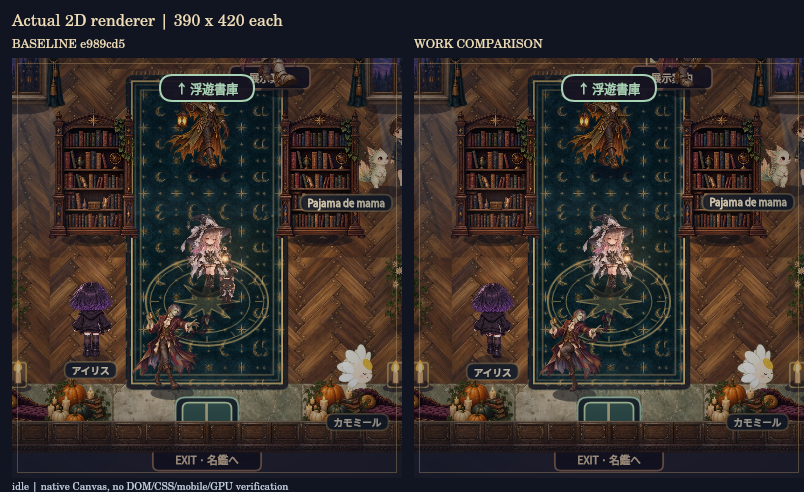

# 無名S note / Halloween Atelier — Work改修

今回の継続分の公開GitHub作業ブランチへの保存は、2026年10月17日にユーザーの明示許可を得ました。mainと既存GitHub Pagesは更新せず、比較用の作業ブランチへ保存します。

制作元はこのGitHubリポジトリの `work/atelier-rebuild-20261017` ブランチ。城・展示・既存の宮殿探索を保ち、新しい「星灯りの城下町」、CNAの三人、全参加者の画像照合、画面サイズと左右操作の設定を追加した作業版です。城下町には実際の3D背景を描く表示も追加しています。mainと既存公開版は変更していません。

**全体完成は未達。** 主人公の歩行・停止・向き直り・攻撃をつなぐ連続原画、全キャストへの作画展開、実ブラウザーと実機の品質確認が残ります。追加制作した主人公v3/v4も支持脚の整合を満たさず不採用です。城下町の専用住民絵も静止画で、全員のアニメーション合格とは扱いません。

## 開く場所

- [城下町の作業版で遊ぶ](https://mumei-atelier-work-review.sabosan0404.chatgpt.site/current/halloween-exhibition/preview/town/) / [作業版の入口](https://mumei-atelier-work-review.sabosan0404.chatgpt.site/current/halloween-exhibition/preview/) / [基準版](https://mumei-atelier-work-review.sabosan0404.chatgpt.site/baseline/halloween-exhibition/preview/)：今回の[分離したSites作業先](https://mumei-atelier-work-review.sabosan0404.chatgpt.site)です。元のmain・既存公開版とは別です。
- [城下町の起点](../town/index.html)：宮殿の「城の外を歩く」からも移動できます。
- [公式アイコンと採用キャラクターの照合](cast-check.html)：全15名。まりもの表紙と採用元の違い、CNAの今回指定した三人も確認できます。
- [修正内容・検証・残件](RESULTS_JA.md)
- [基準版と作業版の起動方法・保存・戻し方](OPERATIONS_JA.md)
- [開始時点の全画面・機能の棚卸し](INVENTORY_JA.md)
- [主人公原画2案の不採用理由](ASSET_REVIEW_JA.md)
- [追加した主人公v3/v4の不採用理由](assets/OWNER_ANIMATION_V3_V4_REVIEW_JA.md)
- [画面サイズ・横画面・操作位置](SCREEN_FIT_JA.md)
- [最終テストログ](test-results.txt) / [変更ファイル・コミット記録](CHANGESET.json)

GitHub上のHTMLリンクはソースの閲覧先です。動く作業版は上記のSites URLから開けます。ローカル比較を行う場合は、運用資料の静的HTTPサーバー手順を使用してください。Sitesへの配信は、実ブラウザー・実機・GPUでの品質合格を意味しません。

## 今回の追加

| 対象 | 内容 |
|---|---|
| 城下町 | 64×48の屋外、5つの屋内、三幕の本筋、2つの寄り道、2つの戦闘、会話・探索・保存 |
| 町の3D表示 | `town/world-3d.js` の立体的な建物・屋根・地形・室内を、55度の見下ろしカメラで描画。人物は承認済み画像を使うスプライト |
| 表示の切り替え | 町は保存済みの2D指定がなければ3Dを初期選択。準備中・利用不能時はCanvasで続きを遊べ、設定から2D/3Dと再試行を選択。同じ町の進行を使用 |
| 画面と操作 | 画面フィット・枠70〜100%・操作100〜125%・左右入れ替え・対応ブラウザーの全画面。宮殿のボタン重なり、縮小横画面、拡大文字の行高を修正 |
| 架空の住人 | 10体の専用イラスト。参加者と主人公の同行者とは別。各一姿勢の静止画で、歩行完成ではない |
| 参加者 | 登録15名を主人公と14組の来訪者として対応。正式名・記事・人物と動物の組を保持 |
| CNA運営 | 今回承認された三人をプロフィールゲストとして追加。記事は未提出のまま、架空の記事リンクなし |
| 全員の見比べ | 公式アイコンと採用画像を同じ高さで表示。全方向・歩行セルと出典・ハッシュを確認可能 |
| 再開と読み込み | 町の任意の景色待ちを開始条件から外し、来訪者の加減速を調整。展示の正式名表示とBFCache復帰時の自動送りを修正 |

現在は主人公1、既存NPC16、CNAゲスト3、黒猫同行者1で**21アトラス・25実体**。提出済み14名・未提出CNA1名、記事の扉16枚は維持しています。CNA追加の明示承認に従って人物manifestを増分変更し、他の既存正本データは保持しました。

## 基盤修正時の比較動画

以下は**CNAの三人と新しい町を追加する前**に、実際のCanvasコードから生成した資料です。左右各390×420。ブラウザー・実機・WebGLの録画ではなく、既存4コマや瞬間的な方向切替の限界も含みます。現在の全キャスト・町の検証済み動画として扱いません。

| 動画 | 内容 |
|---|---|
| [探索・歩行・停止](evidence/exploration-comparison.mp4) | 12秒、基準と基盤修正版の同じ入力・速度上限 |
| [必殺技](evidence/special-move-comparison.mp4) | 6秒、既存shine演出。専用攻撃原画は未完成 |
| [城のキャスト](evidence/castle-cast-comparison.mp4) | 8秒。門のDOM/CSS演出は含まない |
| [当時の30描画役](evidence/all-cast-review.mp4) | 240秒、当時の18人物/同行者＋2住人＋10敵。CNA3人・町の専用住民10体は含まない |

現在の画像対応は[照合ページ](cast-check.html)と[照合結果](evidence/cast-comparison/REPORT_JA.md)を参照してください。自動テストの最新の範囲・件数・合否、既存データ・素材の保持検査は[テストログ](test-results.txt)を正とします。過去の740件は今回の継続改修前の記録で、最新件数として使いません。3Dの数値・構造検査と、実際のブラウザー/GPUの描画検証は別です。

初回基盤コミットは `7924aabf93b3a1a2a61d44cef28e65af81522de9`。最新の成果と配信記録は非公開比較版の `CHANGESET.json` を参照してください。現在のshellキャッシュ定義はv33 town2です。mainへの自動merge、本番カウンター送信、別イラスト制作アプリやINSIGHTの変更は行っていません。管理されたSites環境の制約に従い、実ブラウザー・iPhone/iPad/Android・WebGL/GPU・実音の確認は未実施です。
